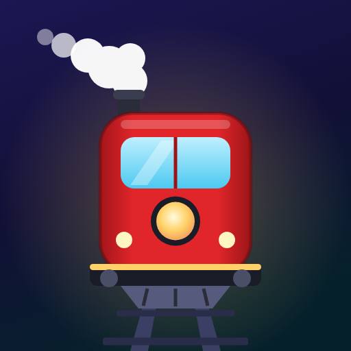

# Unjammed 🚂

**A calm train yard puzzle for kids and grown-ups · Et roligt togpuslespil for børn og voksne**
Developed by / Udviklet af **NoADs Games ApS**

👉 **[Play / Spil Unjammed](https://BRUGERNAVN.github.io/unjammed/)**

[English](#english) · [Dansk](#dansk)

---

## English

Trains are jammed in the yard, and each one can only drive the way its locomotive points.
Free a train and it rolls up to a platform. Passengers wait in line in coloured jackets and
board front to back, and only onto a train in their own colour. When a train is full, it puffs
out a cloud of steam and departs.

Easy to learn, and properly tricky by depot 100.

### How to play

1. Tap a train whose track ahead is clear. It drives to a free platform.
2. The person at the front of the line boards if a platform has a train in their colour.
3. A full train departs on its own and frees the platform.
4. Get every passenger aboard for a perfect run ★

### What's inside

- **100 depots** on yards that grow from 3×3 to 10×10, getting harder step by step
- **A boss depot** at the end of each yard size, with more colours, longer trains and deeper jams
- **3 platforms** to start with, and two more you can earn
- **Every colour has its own shape** (turn it on in Settings), so you can play colour blind
- **English and Danish**
- **No ads, no timers, no tracking**. Nothing is collected, and progress stays on your device.
- **Every depot can be solved to 100%**, and every solution has been checked by computer

### Install on iPhone or iPad

Open the link in Safari and tap **Share → Add to Home Screen**. Unjammed then works like an
app, offline too.

---

## Dansk

Togene sidder fast på banegården, og hvert tog kan kun køre ud den vej, lokomotivet peger.
Frigør et tog, og det ruller op til en perron. Passagererne venter i kø i farvede jakker og
stiger på forfra, og kun på et tog i deres egen farve. Når et tog er fuldt, damper det afsted.

Let at lære, og rigtig svært, når du når bane 100.

### Sådan spiller du

1. Tryk på et tog, der har frit spor foran sig. Det kører op til en ledig perron.
2. Den forreste i køen stiger på, hvis en perron har et tog i hendes farve.
3. Et fuldt tog kører af sig selv og gør perronen ledig.
4. Få alle passagerer med for en perfekt runde ★

### Det får du

- **100 baner** på banegårde, der vokser fra 3×3 til 10×10 og bliver sværere skridt for skridt
- **En boss-bane** til sidst i hver størrelse, med flere farver, længere tog og dybere knuder
- **3 perroner** fra start og to mere, du kan tjene dig til
- **Hver farve har sin egen form** (slå det til i Indstillinger), så spillet kan spilles farveblind
- **Engelsk og dansk**
- **Ingen reklamer, ingen tidspres, ingen sporing**. Intet bliver indsamlet, og din fremgang bliver på din enhed.
- **Alle baner kan klares til 100 %**, og alle løsninger er tjekket af computer

### Læg spillet på iPhone eller iPad

Åbn linket i Safari, og tryk **Del → Føj til hjemmeskærm**. Så virker Unjammed som en app,
også uden internet.

---

© 2026 NoADs Games ApS. Made in Denmark · Lavet i Danmark. All rights reserved · Alle rettigheder forbeholdes.
